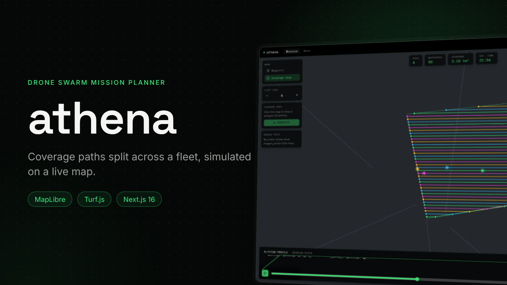
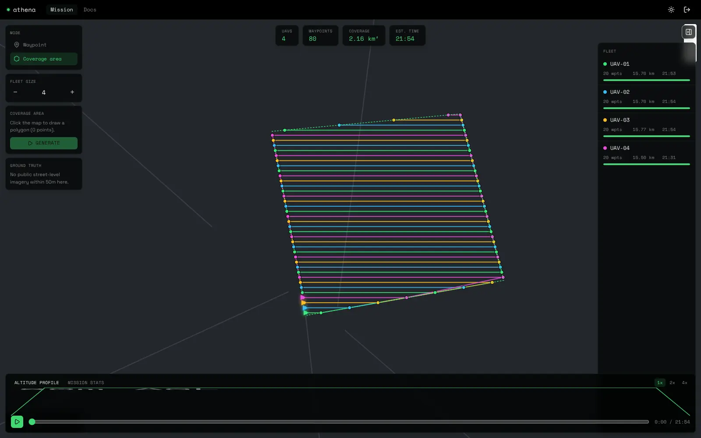
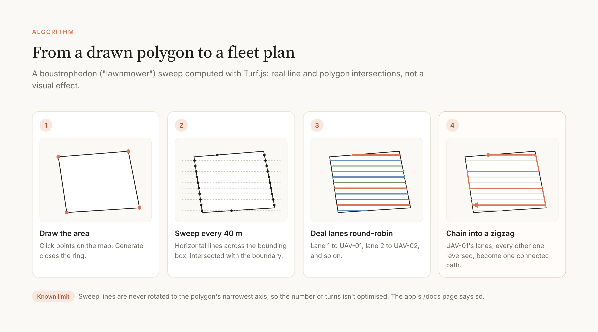
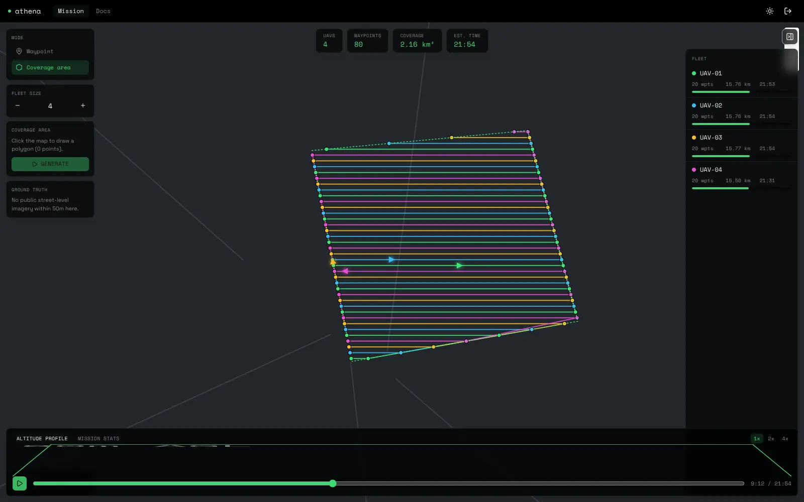

# Athena



**A drone swarm mission planner.** Named for the Greek goddess of strategy, planning rather than brute force. Draw waypoints or a coverage area on a real map, generate a boustrophedon ("lawnmower") coverage path split across a fleet with real computational geometry, and play back a client-side simulation of the swarm flying it.

Part of [Siegfried](https://github.com/joshrubio/Siegfried), a series of five satellite projects. Case study: [joshrubio.es/projects/athena](https://joshrubio.es/projects/athena)

This is deliberately **not** trying to fly real aircraft. There's no MAVLink or flight-controller protocol, no physics engine and no airspace or battery-reserve validation, unlike [QGroundControl](https://qgroundcontrol.com) or [DJI FlightHub 2](https://enterprise.dji.com/flighthub-2). See `/docs` in the app for the full "what this is / isn't" writeup.



## What's real here

- **The map**: [MapLibre GL JS](https://maplibre.org) over CARTO's free dark-matter vector basemap. Real streets and geography, no API key.
- **The coverage algorithm**: [Turf.js](https://turfjs.org) computes real sweep-line and polygon intersections to turn a drawn polygon into lane segments, which are dealt across the fleet and chained into flyable paths.
- **Ground truth**: clicking the map queries [Mapillary](https://www.mapillary.com)'s Image Radius Search for the nearest real public street-level photo within 50 m, through a server route so the token never reaches the browser. It is labelled as a real photo for context, not the drone's camera.

Everything else (positions, battery, altitude) is a simple, disclosed kinematic simulation (`lib/simulate.ts`): constant cruise speed along straight segments, linear battery drain, and a flat altitude hold with a short take-off and landing ramp.

## The coverage algorithm



`lib/coverage.ts` sweeps horizontal lines every 40 m across the polygon's bounding box and pairs their crossings with the boundary into lanes. Lanes are dealt round-robin across the drones, and every other lane is reversed so each drone's legs connect end to end.

Known limitation, also stated in `/docs`: the sweep is never rotated to the polygon's narrowest axis, so the number of turns isn't optimised.

## The mission view

The layout borrows QGroundControl's Plan View grammar and DJI FlightHub 2's floating glass tiles: a left tool strip (waypoint or coverage mode, active drone, fleet size, Generate, ground truth), KPI tiles (drones, waypoints, coverage area, estimated time), a collapsible fleet panel, and a bottom bar with the altitude profile or mission stats plus play, speed and a scrubber.



*README screenshots were captured with a simplified fallback basemap; the running app shows CARTO's full street map.*

## Identity

A near-black radar-scope backdrop, a phosphor-green accent reserved for functional signals, Space Grotesk for UI chrome paired with Space Mono for telemetry and coordinates, and a small glass-panel radius with backdrop blur.

## Running locally

```bash
npm install
npm run dev
```

The ground-truth panel needs a free `MAPILLARY_CLIENT_TOKEN` in `.env.local` (register at [mapillary.com/dashboard/developers](https://www.mapillary.com/dashboard/developers)); everything else works without keys. The login page is a demo gate.

### A maplibre-gl + Turbopack note

`maplibre-gl`'s default `new Worker(new URL(...))` path doesn't resolve under Turbopack, in dev or in a production build. `dist/maplibre-gl-worker.mjs` is copied into `public/` and set explicitly with `maplibregl.setWorkerUrl()` before the first `Map` is created (see `components/mission/MissionMap.tsx`). Re-run that copy step if `maplibre-gl` is upgraded.

## Stack

Next.js 16 (App Router, Cache Components) · TypeScript · Tailwind CSS v4 · shadcn/ui (`@base-ui/react`) · MapLibre GL JS · Turf.js · Mapillary (Graph API v4).
